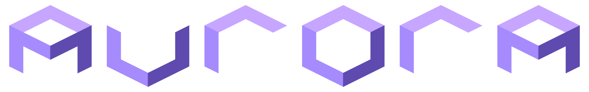

  

 

Aurora is a source-level GameCube & Wii compatibility layer. This folder is the copy Other M Recompiled builds, with
the port's own changes; the runtime's CMake (`runtime/CMakeLists.txt`) builds it as part of the game.

### Features

- Application layer using SDL3
- GX compatibility layer on [WebGPU](https://www.w3.org/TR/webgpu/) (Chromium's [Dawn](https://dawn.googlesource.com/dawn/)):
  Direct3D 12, Vulkan and Metal
  - Pipeline cache with a seed shipped with each release, and ubershaders while pipelines compile
  - Dolphin-compatible texture packs
  - Resolution scaling, widescreen and ultrawide, frame interpolation
- PAD compatibility layer on `SDL_Gamepad`, with gyro and mouse support
- DVD compatibility layer on [nod](https://github.com/encounter/nod): every GameCube/Wii disc image type, including RVZ
- [Dear ImGui](https://github.com/ocornut/imgui) for the port's menus

### License

Aurora is by Luke Street and contributors, under the [MIT License](LICENSE).
